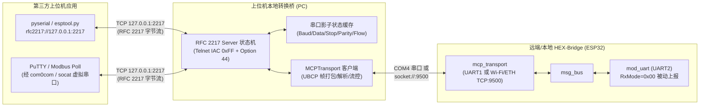

# 4. UART 扩展模块设计

## 4.1 概述

UART 扩展模块实现 UBCP 的 UART 命令组 (0xA0–0xAF)。UART2 使用通道 1，Profile v4 可将 UART1 配置为普通串口并使用通道 2。拓扑和 UART 通道计数随业务实例的启用状态变化。每路独立处理波特率、收发模式、事件和关闭操作。

UART1 普通串口固定使用 GPIO4 (TX)、GPIO34 (RX)。只有关闭 UART1 管理并启用普通串口后，通道 2 才可打开；通过 Wi-Fi TCP 9500 管理连接配置和收发。两个角色都关闭时，这两脚仍保留。

### UART2 默认硬件配置

| 参数 | 值 |
|:---|:---|
| UART 端口 | UART2 |
| TX 引脚 | GPIO 32 (原 GPIO 2 已弃用，与 I2C SCL 互换避免 Strapping 冲突) |
| RX 引脚 | GPIO 35 (GPI, 外接 10kΩ 上拉) |
| 默认波特率 | 115,200 bps |
| RX 缓冲区 | 2048 字节 |
| TX 缓冲区 | 1024 字节 |

## 4.2 命令实现状态

| 命令码 | 名称 | 状态 |
|:---|:---|:---|
| `0xA0` | UART_OPEN | ✅ 完整实现 |
| `0xA1` | UART_CLOSE | ✅ 完整实现 |
| `0xA2` | UART_CONFIG | ✅ 完整实现 |
| `0xA3` | UART_SEND | ✅ 完整实现 |
| `0xA4` | UART_RECV | ✅ 事件上报（4 种接收模式） |
| `0xA5` | UART_SET_BREAK | ✅ 完整实现 |
| `0xA6` | UART_STATUS | ✅ 完整实现 |
| `0xA7` | UART_FLUSH | ✅ 完整实现 |

## 4.3 接收模式

### 被动上报模式 (RxMode = 0x00)

收到数据立即上报。每次从对应业务串口读取到的数据（最多 512 字节批次）打包为一个 UART_RECV 事件帧。

### 行模式 (RxMode = 0x01)

缓存数据直到遇到 `\n`（支持 `\r\n`），整行上报。行缓冲区 1024 字节，超长自动截断上报。

### 定长模式 (RxMode = 0x02)

累积数据直到达到 `RxThreshold` 字节后上报。适用于固定长度协议。

### 超时模式 (RxMode = 0x03)

收到首字节后，如果 `RxTimeout` 毫秒内无新数据则上报。适用于不定长消息（如 Modbus RTU）。

## 4.4 生命周期

```
上位机                                   设备 (UART 模块)

UART_OPEN(RxMode) ──────────────────→   安装 UART2 驱动
                                         创建 RX 接收任务
                   ←────────────────── 响应(Status, BufSize)

UART_CONFIG(波特率, 8N1) ────────────→   配置 UART2 参数
                   ←────────────────── 响应(ActualBaud)

UART_SEND("Hello") ─────────────────→   uart_write_bytes()
                   ←────────────────── 响应(ActualLen)

                   ←────────────────── UART_RECV 事件上报
                   ←────────────────── UART_RECV 事件上报
                                        (RX 任务持续上报)

UART_STATUS() ───────────────────────→   查询状态
                   ←────────────────── 响应(波特率, 计数器...)

UART_CLOSE() ────────────────────────→   停止 RX 任务
                                         卸载 UART2 驱动
                   ←────────────────── 响应(Status)
```

## 4.5 FLUSH 实现

`UART_FLUSH (0xA7)` 支持 RX / TX / ALL / DRAIN 四种清空操作。

TX 排空**不采用** `uart_wait_tx_done()` 纯阻塞等待，原因：MCP Serial Monitor 插件 UBCP 响应超时 < 1s，而 `uart_wait_tx_done` 可能阻塞长达 1s 导致命令超时。

**方案**：轮询 `uart_get_tx_buffer_free_size()` 检测 TX 是否排空，轮询间隔内通过 `vTaskDelay` 让出 CPU，TX 排空即返回，最大等待 200ms。

> 在 115200 bps 下，满 1024 字节 TX 缓冲区排空约需 89ms，200ms 上限留有充足余量。

## 4.6 源文件

| 文件 | 说明 |
|:---|:---|
| `modules/mod_uart.h` | 接口声明 |
| `modules/mod_uart.c` | 完整实现（~1043 行） |
| `script/cli/hex-bridge-rfc2217-bridge.py` | 上位机 RFC 2217 ↔ UBCP 转换桥（规划） |

---

## 4.7 上位机 `本地 RFC 2217 端口 ↔ 远端 ESP32 UBCP (TCP/Serial)` 转换桥设计规划

### 4.7.1 背景与设计决策

为了在不增加 ESP32 固件复杂度、不破坏 `mod_uart.c` 对 `UART2` 唯一控制权的前提下，同时获得 **RFC 2217 的第三方串口工具链生态兼容性**（如 `pyserial`、`esptool.py`、PuTTY、虚拟串口驱动 `com0com` / `socat`）与 **UBCP 单链路全外设多路复用 / Wi-Fi 远程能力**，采用**上位机侧协议桥接方案**：

- **固件侧零侵入**：ESP32 固件仅运行统一的 UBCP 协议栈（物理链路可为本地 `UART1` 串口，或 Wi-Fi STA 上的 `TCP Socket`）。
- **上位机侧本地代理**：在 PC 上运行轻量级桥接服务（监听本地 `127.0.0.1:2217`），对外提供标准的 **RFC 2217 (Telnet Com Port Control Option)** 服务端，对内将控制选项和数据流实时翻译为 **UBCP UART 命令 (`0xA0-0xA7`)**。

### 4.7.2 端到端拓扑架构



### 4.7.3 连接生命周期映射

| 阶段 | RFC 2217 客户端动作 | 转换桥 (Bridge) 内部处理 | 对应的 UBCP 帧交互 (`Channel = 1`) |
|:---|:---|:---|:---|
| **1. 建立连接** | 客户端 `connect(127.0.0.1:2217)` | 1. 接受 TCP 连接（单客户端独占或踢出旧连接）<br>2. 初始化影子配置：`115200, 8N1, Flow=None`<br>3. 打开远端 UART 通道并设为**被动透传模式** | 发送 `UART_OPEN (0xA0)`：`RxMode = 0x00 (PASSIVE)`<br>发送 `UART_CONFIG (0xA2)`：`RxThreshold = 1` |
| **2. Telnet 握手** | 发送 `IAC DO COM-PORT-OPTION (44)`<br>`IAC WILL BINARY (0)` 等 | 响应 `IAC WILL 44`、`IAC DO 0`、`IAC WILL 0`、`IAC DO 3 (SGA)`，进入二进制透明传输态 | 无（本地协议栈完成握手） |
| **3. 动态改参** | 发送 `IAC SB 44 <SubCmd> <Val> IAC SE` | 更新影子状态缓存，组合完整参数后下发 UBCP 配置，等待响应后回填 `+100` 确认帧 | 发送 `UART_CONFIG (0xA2)`，读取响应中的 `ActualBaud` |
| **4. 断开连接** | 客户端关闭 TCP Socket | 清理客户端会话；根据启动参数决定保持通道打开或自动关闭驱动 | 发送 `UART_CLOSE (0xA1)`（默认关闭以释放硬件资源） |

### 4.7.4 RFC 2217 子命令 (Option 44) 与 UBCP 命令精确映射表

RFC 2217 子协商帧格式为：`IAC (0xFF) SB (0xFA) 44 (0x2C) <Command> <Value...> IAC (0xFF) SE (0xF0)`。服务端响应命令码恒为 `<Command> + 100`。

| RFC 2217 客户端命令 (Client → Server) | 命令值 | Value 编码 | 转换桥 (Bridge) 映射的 UBCP 操作 | RFC 2217 服务端响应 (Server → Client) |
|:---|:---|:---|:---|:---|
| `SET-BAUDRATE` | `1` | `u32` 大端序 (`0` = 查询当前波特率) | 若非 0：更新影子 `BaudRate`，调用 `UART_CONFIG (0xA2)`；若为 0：调用 `UART_STATUS (0xA6)` 查询 | `101` + `ActualBaud (u32 大端序)` |
| `SET-DATASIZE` | `2` | `u8`：`5`~`8` (`0` = 查询) | 更新影子 `DataBits` (`0x05`~`0x08`)，调用 `UART_CONFIG (0xA2)` | `102` + `DataBits (u8)` |
| `SET-PARITY` | `3` | `1`=NONE, `2`=ODD, `3`=EVEN, `4`=MARK, `5`=SPACE | 映射为 UBCP `Parity`：`0x00`~`0x04`（注意：**UBCP 值 = RFC2217 值 - 1**），调用 `UART_CONFIG (0xA2)` | `103` + `Parity (u8)` |
| `SET-STOPSIZE` | `4` | `1`=1位, `2`=2位, `3`=1.5位 | 映射为 UBCP `StopBits`：<br>• RFC `1` (1位) → UBCP `0x01`<br>• RFC `2` (2位) → UBCP `0x03`<br>• RFC `3` (1.5位) → UBCP `0x02`<br>（**注意 2 位与 1.5 位枚举值互换！**） | `104` + `StopSize (u8)` |
| `SET-CONTROL` (流控) | `5` | `1`=无流控<br>`2`=XON/XOFF<br>`3`=硬件 RTS/CTS | 映射为 UBCP `FlowControl`：<br>• RFC `1` → UBCP `0x00`<br>• RFC `2` → UBCP `0x02`<br>• RFC `3` → UBCP `0x01`<br>调用 `UART_CONFIG (0xA2)` | `105` + `<Value>` |
| `SET-CONTROL` (Break) | `5` | `5`=Break ON<br>`6`=Break OFF | 收到 `5` 时调用 `UART_SET_BREAK (0xA5)`（`DurationMs = 100` 或配置值） | `105` + `5` (或 `6`) |
| `SET-CONTROL` (DTR/RTS) | `5` | `8`=DTR ON, `9`=DTR OFF<br>`11`=RTS ON, `12`=RTS OFF | 当前硬件 `UART2` 无独立 DTR/RTS 引脚，在影子状态中记录电平并直接返回成功（保证 `esptool`/`pyserial` 不报错） | `105` + `<Value>` |
| `SET-LINESTATE-MASK` | `10` | `u8` 位掩码 | 保存客户端感兴趣的 `linestate_mask`，用于过滤后续 `UART_RECV` 的 `RxFlags` | `110` + `<Mask>` |
| `SET-MODEMSTATE-MASK` | `11` | `u8` 位掩码 | 保存 `modemstate_mask`，并立即发送一次模拟 `NOTIFY-MODEMSTATE (107)` (`CTS=1, DSR=1, DCD=1`) | `111` + `<Mask>` |
| `PURGE-DATA` | `12` | `1`=清空 RX<br>`2`=清空 TX<br>`3`=清空 RX+TX | 映射为 `UART_FLUSH (0xA7)`：<br>• RFC `1` → `FlushType = 0x00 (RX)`<br>• RFC `2` → `FlushType = 0x01 (TX)`<br>• RFC `3` → `FlushType = 0x02 (ALL)` | `112` + `<Value>` |

### 4.7.5 双向数据流转义与异常状态主动通知 (`NOTIFY-LINESTATE`)

1. **下行数据流（RFC 2217 Client → Bridge → UBCP `UART_SEND 0xA3`）**：
   - **IAC 反转义**：解析器从 TCP Socket 读取字节流，遇到 `0xFF 0xFF` 还原为单字节数据 `0xFF`；遇到 `0xFF <Cmd>` 进入 Telnet 控制状态机，不混入串口发送数据。
   - **微批聚合（Nagle 聚合）**：为避免客户端逐字节 `write(1)` 导致产生大量 1 字节的 UBCP 帧开销，Bridge 采用 **“2ms 微延时或凑满 1024 字节立即发送”** 策略：
     - 当收到首个数据字节后，若底层 UBCP 发送空闲则立即或最多等待 `2ms` 聚合后续字节，打包为单帧 `UART_SEND (0xA3)`（单帧最大载荷 `1024` 字节，匹配固件 `HEX_EXT_UART_TX_BUF_SIZE`）。
2. **上行数据流（UBCP `UART_RECV 0xA4` → Bridge → RFC 2217 Client）**：
   - Bridge 异步监听 `UART_RECV (0xA4)` 事件帧（载荷：`[RxFlags(u8)][DataLen(u16)][Data...]`）。
   - **错误状态转译 (`RxFlags` → `NOTIFY-LINESTATE 106`)**：
     如果 `RxFlags != 0`，将 UBCP `RxFlags` 转换为 RFC 2217 的 `LineState` 位图：
     - `UBCP Bit 0 (BufferOverflow)` → `RFC2217 Bit 1 (Overrun Error = 0x02)`
     - `UBCP Bit 1 (ParityError)` → `RFC2217 Bit 2 (Parity Error = 0x04)`
     - `UBCP Bit 2 (FrameError)` → `RFC2217 Bit 3 (Framing Error = 0x08)`
     - `UBCP Bit 3 (BreakDetect)` → `RFC2217 Bit 4 (Break Detect = 0x10)`
     若转换后的 `(rfc_linestate & client_linestate_mask) != 0`，先向客户端发送 `IAC SB 44 106 <rfc_linestate> IAC SE`。
   - **数据 `0xFF` 转义**：检查 `Data` 中是否包含 `0xFF`，将其替换为 `0xFF 0xFF`（即 `data.replace(b'\xff', b'\xff\xff')`），然后写入客户端 TCP Socket。

### 4.7.6 流控背压联动（UBCP `FLOW_CONTROL 0x05` ↔ RFC 2217）

当远端 `UART2` 接收或发送高负载触发固件水位告警时：
1. **收到固件 `FLOW_CONTROL (0x05, Action=0x00 XOFF, ModuleID=0xA0)`**：
   - Bridge 向 RFC 2217 客户端发送 `IAC SB 44 108 (FLOWCONTROL-SUSPEND) IAC SE`。
   - 同时暂停从客户端 TCP Socket `recv()` 数据，利用操作系统 TCP 接收窗口向客户端施加自然背压。
2. **收到固件 `FLOW_CONTROL (0x05, Action=0x01 XON, ModuleID=0xA0)`**：
   - Bridge 向客户端发送 `IAC SB 44 109 (FLOWCONTROL-RESUME) IAC SE`，并恢复读取客户端 TCP Socket。

### 4.7.7 启动方式与接口规范（实现参考）

规划脚本路径：`script/cli/hex-bridge-rfc2217-bridge.py`（亦可作为子命令集成于 `hex-bridge-uart-cli.py`）。

```bash
# 场景 1：本地 USB 串口连接 ESP32，暴露 RFC 2217 端口给本机第三方软件
python script/cli/hex-bridge-rfc2217-bridge.py --mcp COM4 --mcp-baud 921600 --listen 127.0.0.1:2217 --channel 1

# 场景 2：通过 Wi-Fi 远程连接 ESP32 UBCP TCP 端口，暴露本地 RFC 2217 端口
python script/cli/hex-bridge-rfc2217-bridge.py --mcp socket://192.168.1.100:9500 --listen 127.0.0.1:2217 --channel 1
```

启动后，任何第三方工具均可直接连接：
- **pyserial / Python 脚本**：`serial.serial_for_url("rfc2217://127.0.0.1:2217?ign_set_control", baudrate=115200)`
- **esptool.py 远程烧录其他目标板**：`esptool.py --port rfc2217://127.0.0.1:2217 flash_id`
- **Windows / Linux 传统串口软件**：通过 `com0com + hub4com` 或 `socat pty,link=/dev/ttyV0,raw tcp:127.0.0.1:2217` 挂载为操作系统标准串口。

